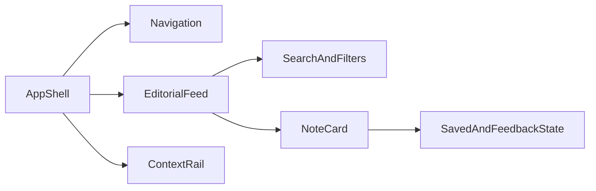

# Investigación de arquitectura — v0.1

## Estructura propuesta

## División de responsabilidades

- `AppShell`: composición responsive y landmarks.
- `Navigation`: navegación principal y estados activos.
- `EditorialFeed`: orden, filtrado y estado vacío.
- `NoteCard`: presentación de una nota, fuente, etiquetas y acciones.
- `ContextRail`: pulso, temas conversados y principios editoriales.
- `SearchAndFilters`: controles de descubrimiento con teclado.

## Datos simulados

Mantener los datos mock en una colección local con campos equivalentes a la futura API: `id`, `title`, `summary`, `source`, `time`, `tags`, `comments`, `shares`, `status` y `accent`. La forma debe facilitar sustituir la fuente local por `/notes/` después.

## Principios técnicos

- Preferir HTML semántico y controles nativos.
- Mantener los estados de UI locales y explícitos.
- Usar `:focus-visible` sin eliminar el foco del navegador.
- Animar únicamente transformaciones y opacidad.
- Proporcionar una variante útil cuando una búsqueda no devuelve resultados.
