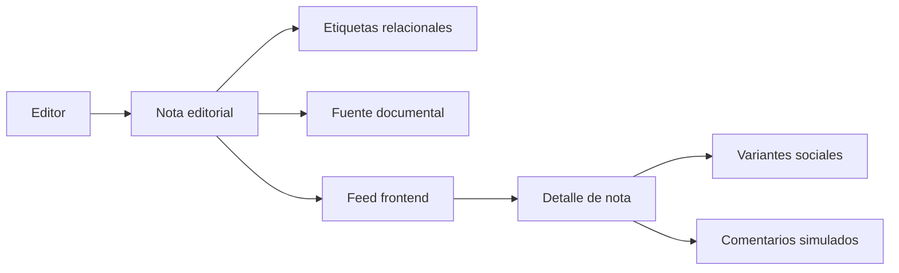

# Documentación técnica de MazaCrítica

## 1. Propósito

MazaCrítica es un medio editorial cívico con una experiencia social de lectura. Los editores producen las notas; las personas registradas participan mediante comentarios con nickname. El frontend debe facilitar el descubrimiento, mostrar contexto y adaptar una nota editorial a presentaciones para Facebook, Instagram y TikTok.

El producto también contempla una sección del Poder Judicial y una base de datos de candidatos para elecciones presentes y futuras. Las elecciones se consultarán por código postal y se relacionarán con zonas electorales oficiales, cuya vigencia y fuente deberán quedar registradas.

## 2. Arquitectura actual

### Backend

El backend está construido con:

- Django 5.2 LTS.
- Django REST Framework.
- SQLite para desarrollo.
- Django Admin.

La versión objetivo de Python es `3.14.7`, definida en `.python-version` y soportada oficialmente por Django 5.2. Python 3.15.0 ya fue publicado, pero aún no se usa porque Django no declara soporte oficial para esa versión.

La aplicación principal es `mazacritica/api/`. Las rutas del proyecto incluyen `api.urls` desde la raíz, por lo que los endpoints no llevan el prefijo `/api/`.

### Frontend

El frontend está construido con:

- React.
- Vite.
- CSS propio.
- ESLint.

La implementación actual está concentrada en `mazacritica/frontend/src/App.jsx` y `App.css`. Usa datos simulados para demostrar la experiencia editorial y no realiza solicitudes a la API todavía.

## 3. Flujo actual



## 4. Datos implementados

### `Tag`

Representa un tema o estado editorial.

Campos principales:

- `name`
- `slug`
- `kind`: `topic` o `status`
- `description`
- `is_active`

### `Source`

Representa una fuente documental asociada a una nota.

Campos principales:

- `name`
- `url`
- `publisher`
- `published_at`
- `reference_notes`

### `Note`

Representa una nota editorial.

Campos principales:

- `title`
- `slug`
- `excerpt`
- `content`
- `status`: `draft`, `published` o `archived`
- `source`
- `tags`
- `author`
- `published_at`
- `created_at`
- `updated_at`

Relaciones:

```text
Source 1 ─── N Note
Tag    N ─── N Note
User   1 ─── N Note
```

## 5. Reglas de visibilidad

- Visitantes: pueden consultar notas publicadas.
- Usuarios autenticados: pueden consultar notas y operar sobre el contenido permitido por la API actual.
- Editores: serán el rol responsable de crear y publicar notas.
- Comentadores: podrán comentar cuando se implemente la autenticación y el modelo de comentarios.

La autorización editorial todavía necesita una política específica de roles. El modelo actual usa el usuario estándar de Django y permisos generales de DRF como base inicial.

## 6. Frontend actual

La portada incluye:

- Navegación lateral en acordeón.
- Header que se oculta al bajar y reaparece al subir.
- Feed editorial.
- Búsqueda local.
- Filtros por etiquetas.
- Orden por relevancia simulada, fecha y conversación.
- Guardado local simulado.
- Detalle de nota.
- Estado de la información.
- Identidad editorial.
- Variantes visuales para Facebook, Instagram y TikTok.
- Comentarios simulados con nickname.
- Estados vacíos y mensajes de interacción.

Las acciones de comentario, respuesta, reporte y participación muestran mensajes de prototipo hasta que exista persistencia real.

## 7. Funcionalidades planeadas

### Sección del Poder Judicial

Debe permitir consultar notas, procesos, resoluciones y personas relacionadas con el Poder Judicial. Los estados deben conservar la diferencia entre investigación, señalamiento, proceso y resolución firme.

### Módulo electoral

Entidades previstas:

- `Election`
- `Office`
- `Candidate`
- `Candidacy`
- `PostalCode`
- `ElectionZone`
- `PostalCodeZoneMapping`

El código postal servirá como entrada para la búsqueda. La candidatura aplicable debe determinarse mediante una relación oficial y fechada con una zona electoral. Un código postal puede relacionarse con más de una zona.

### Comentarios

Entidades previstas:

- `Comment`
- `CommentReport`
- `ModerationAction`

Los comentarios deben pertenecer a una nota, mostrar nickname y conservar un estado de moderación. Las notas continuarán siendo exclusivas de editores.

## 8. Política de etiquetas sensibles

No usar `corrupción` como etiqueta factual cuando solo existe una sospecha. Preferir:

- `Señalamiento`
- `Denuncia presentada`
- `Investigación en curso`
- `Presunta irregularidad`
- `Proceso judicial`
- `Resolución firme`

Toda nota debe diferenciar hechos documentados, denuncias, investigaciones, análisis y opiniones.

## 9. Flujo de desarrollo recomendado

1. Revisar `README.md`, `memory.md` y `Proposito del proyecto.md`.
2. Revisar el diseño aprobado en `docs/brainstorm/`.
3. Definir el alcance y los permisos antes de crear modelos.
4. Crear migraciones para cada cambio de datos.
5. Añadir pruebas para relaciones, permisos y filtros.
6. Mantener el frontend con datos mock hasta que la API esté estable.
7. Ejecutar `manage.py check`, `manage.py test`, `npm run lint` y `npm run build`.

## 10. Limitaciones conocidas

- No existe autenticación completa para el frontend.
- No existe un modelo de comentarios en el backend.
- El rol editorial aún no está separado del usuario estándar.
- El frontend no consume `/notes/`, `/tags/` ni `/sources/`.
- No hay integración de publicación con plataformas sociales.
- La base electoral todavía es diseño, no implementación.
- La configuración de estáticos de Django conserva referencias históricas a Webpack mientras el frontend usa Vite.

## 11. Compatibilidad de Python

Para preparar un entorno nuevo:

```bash
pyenv install 3.14.7
pyenv local 3.14.7
python -m venv .venv
source .venv/bin/activate
pip install -r requirements.txt
```

La migración a Python 3.15 debe esperar a que la versión de Django utilizada publique soporte oficial y a que las dependencias del proyecto pasen la suite completa de pruebas.

## 12. Criterios para producción

Antes de desplegar:

- Mover `SECRET_KEY` y credenciales a variables de entorno.
- Desactivar `DEBUG`.
- Configurar `ALLOWED_HOSTS`.
- Definir autenticación y permisos editoriales.
- Añadir política de moderación y reporte.
- Validar fuentes y vigencia de zonas electorales.
- Servir las fuentes tipográficas de forma controlada.
- Conectar frontend y backend con configuración por entorno.
