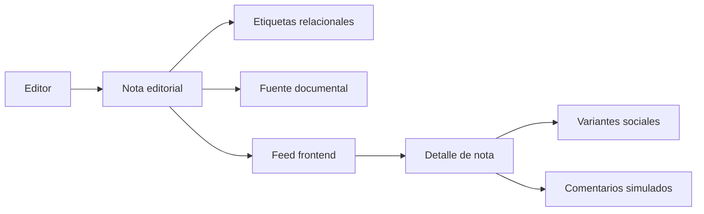

# Documentación técnica de MazaCrítica

## 1. Propósito

MazaCrítica es un medio editorial cívico con una experiencia social de lectura. Los editores producen las notas; las personas registradas participan mediante comentarios con nickname. El frontend debe facilitar el descubrimiento, mostrar contexto y adaptar una nota editorial a presentaciones para Facebook, Instagram y TikTok.

El producto también contempla una sección del Poder Judicial y una base de datos de candidatos para elecciones presentes y futuras. Las elecciones se consultarán por código postal y se relacionarán con zonas electorales oficiales, cuya vigencia y fuente deberán quedar registradas.

## 2. Arquitectura actual

### Backend

El backend está construido con:

- Django 5.2 LTS.
- Django REST Framework.
- SQLite para desarrollo.
- Django Admin.

La versión objetivo de Python es `3.14.7`, definida en `.python-version` y soportada oficialmente por Django 5.2. Python 3.15.0 ya fue publicado, pero aún no se usa porque Django no declara soporte oficial para esa versión.

La aplicación principal es `mazacritica/api/`. Las rutas del proyecto incluyen `api.urls` desde la raíz, por lo que los endpoints no llevan el prefijo `/api/`.

### Frontend

El frontend está construido con:

- React.
- Vite.
- CSS propio.
- ESLint.

La implementación actual está concentrada en `mazacritica/frontend/src/App.jsx` y `App.css`. Usa datos simulados para demostrar la experiencia editorial y no realiza solicitudes a la API todavía.

## 3. Flujo actual



## 4. Datos implementados

### `Tag`

Representa un tema o estado editorial.

Campos principales:

- `name`
- `slug`
- `kind`: `topic` o `status`
- `description`
- `is_active`

### `Source`

Representa una fuente documental asociada a una nota.

Campos principales:

- `name`
- `url`
- `publisher`
- `published_at`
- `reference_notes`

### `Note`

Representa una nota editorial.

Campos principales:

- `title`
- `slug`
- `excerpt`
- `content`
- `status`: `draft`, `published` o `archived`
- `source`
- `tags`
- `author`
- `published_at`
- `created_at`
- `updated_at`

Relaciones:

```text
Source 1 ─── N Note
Tag    N ─── N Note
User   1 ─── N Note
```

## 5. Roles, autenticación y visibilidad

El alcance definido separa cuatro roles. El visitante no tiene cuenta. Los otros tres se asignan con grupos de Django llamados exactamente `member`, `editor` y `moderator`.

| Rol | Grupo | Lectura | Escritura |
|---|---|---|---|
| Visitante | ninguno | Notas publicadas y comentarios visibles | Ninguna |
| Miembro | `member` | Notas publicadas y comentarios visibles | Solo comentarios sobre una nota existente |
| Editor | `editor` | Notas en cualquier estado editorial | Crear, editar, publicar, archivar y eliminar notas, etiquetas y fuentes |
| Moderador | `moderator` | Cola de moderación cuando exista | Acciones de moderación previstas |

La autenticación de la API será `TokenAuthentication` de Django REST Framework, conservando también la autenticación de sesión. El registro (`POST /register/`) recibe `email`, `password` y `nickname`, crea el usuario con `username` igual al nickname normalizado, contraseña hasheada y perfil `UserProfile`, y lo agrega al grupo `member`. El nickname es único, se guarda en minúsculas, mide de 3 a 30 caracteres y cumple `[a-z0-9_]`.

`POST /login/` acepta correo y contraseña, o nombre de usuario y contraseña, y responde `{token, nickname, email, groups}`. Las credenciales incorrectas responden `401`. `POST /logout/` exige token y lo elimina con `204`. `GET /me/` exige token y responde `id`, `email`, `nickname` y `groups`.

Los borradores quedan ocultos para visitantes y miembros. Una nota publicada exige `published_at`. El autor se fuerza al editor autenticado.

## 5.1 Conversación de dos niveles

La conversación replica el límite de Facebook: exactamente dos niveles.

- Un comentario es de primer nivel cuando `parent` es nulo.
- Una respuesta es un comentario cuyo `parent` es un comentario de primer nivel de la misma nota.
- Una respuesta no puede tener respuestas.
- La API responde `400` si `parent` es a su vez una respuesta o si `parent` pertenece a otra nota.
- La lectura pública devuelve comentarios de primer nivel visibles y, anidados o asociados, solo sus respuestas directas visibles.

Cada comentario guarda una instantánea del nickname. El estado inicial es `pending`. Quien no modera solo lee comentarios visibles. Los modelos previstos son `Comment`, `CommentReport` y `ModerationAction`. Una persona del grupo `member` no puede crear notas.

## 6. Frontend actual

La portada incluye:

- Navegación lateral en acordeón.
- Header que se oculta al bajar y reaparece al subir.
- Feed editorial.
- Búsqueda local.
- Filtros por etiquetas.
- Orden por relevancia simulada, fecha y conversación.
- Guardado local simulado.
- Detalle de nota.
- Estado de la información.
- Identidad editorial.
- Variantes visuales para Facebook, Instagram y TikTok.
- Comentarios simulados con nickname.
- Estados vacíos y mensajes de interacción.

Las acciones de comentario, respuesta, reporte y participación muestran mensajes de prototipo hasta que exista persistencia real.

## 7. Funcionalidades planeadas

### Sección del Poder Judicial

Debe permitir consultar notas, procesos, resoluciones y personas relacionadas con el Poder Judicial. Los estados deben conservar la diferencia entre investigación, señalamiento, proceso y resolución firme.

### Módulo electoral

Entidades previstas:

- `Election`
- `Office`
- `Candidate`
- `Candidacy`
- `PostalCode`
- `ElectionZone`
- `PostalCodeZoneMapping`

El código postal es la entrada de búsqueda. La elegibilidad la decide `PostalCodeZoneMapping`: una correspondencia oficial, con fecha de vigencia, entre un `PostalCode` y una `ElectionZone`. Un código postal puede mapear a varias zonas y, por tanto, a varias candidaturas aplicables. La zona oficial no se infiere solo por el texto del código postal.

### Comentarios

Entidades previstas:

- `Comment`
- `CommentReport`
- `ModerationAction`

Un comentario pertenece a una nota y guarda el nickname como instantánea. Empieza en `pending`. La lectura pública solo incluye comentarios visibles.

La profundidad es exactamente dos niveles. `parent` nulo significa comentario de primer nivel. Una respuesta apunta a un comentario de primer nivel de la misma nota. Si el padre ya es una respuesta, o si el padre pertenece a otra nota, la operación se rechaza con `400`. El público ve los comentarios de primer nivel visibles y sus respuestas directas visibles. No existe un tercer nivel.

Las notas, etiquetas y fuentes siguen siendo exclusivas del grupo `editor`. El miembro registrado solo comenta.

### Datos de demostración

El comando `python manage.py seed_demo_data` cargará un conjunto ficticio y determinista de usuarios, notas, comentarios y relaciones electorales. Los mismos datos de entrada deben producir el mismo resultado. Esos registros no representan personas ni procesos reales.

## 8. Política de etiquetas sensibles

No usar `corrupción` como etiqueta factual cuando solo existe una sospecha. Preferir:

- `Señalamiento`
- `Denuncia presentada`
- `Investigación en curso`
- `Presunta irregularidad`
- `Proceso judicial`
- `Resolución firme`

Toda nota debe diferenciar hechos documentados, denuncias, investigaciones, análisis y opiniones.

## 9. Flujo de desarrollo recomendado

1. Revisar `README.md`, `memory.md` y `Proposito del proyecto.md`.
2. Revisar el diseño aprobado en `docs/brainstorm/`.
3. Definir el alcance y los permisos antes de crear modelos.
4. Crear migraciones para cada cambio de datos.
5. Añadir pruebas para relaciones, permisos y filtros.
6. Mantener el frontend con datos mock hasta que la API esté estable.
7. Ejecutar `manage.py check`, `manage.py test`, `npm run lint` y `npm run build`.

## 10. Limitaciones conocidas

- La autenticación por token, el perfil y los grupos `member`, `editor` y `moderator` están definidos y pendientes de implementación.
- No existe todavía un modelo de comentarios. Cuando se implemente, las pruebas del límite de dos niveles deben escribirse antes que el modelo y la API.
- El frontend no consume `/notes/`, `/tags/` ni `/sources/`.
- No hay integración de publicación con plataformas sociales.
- La base electoral y `seed_demo_data` están definidos y todavía no implementados.
- La configuración de estáticos de Django conserva referencias históricas a Webpack mientras el frontend usa Vite.

## 11. Compatibilidad de Python

Para preparar un entorno nuevo:

```bash
pyenv install 3.14.7
pyenv local 3.14.7
python -m venv .venv
source .venv/bin/activate
pip install -r requirements.txt
```

La migración a Python 3.15 debe esperar a que la versión de Django utilizada publique soporte oficial y a que las dependencias del proyecto pasen la suite completa de pruebas.

## 12. Criterios para producción

Antes de desplegar:

- Mover `SECRET_KEY` y credenciales a variables de entorno.
- Desactivar `DEBUG`.
- Configurar `ALLOWED_HOSTS`.
- Definir autenticación y permisos editoriales.
- Añadir política de moderación y reporte.
- Validar fuentes y vigencia de zonas electorales.
- Servir las fuentes tipográficas de forma controlada.
- Conectar frontend y backend con configuración por entorno.
