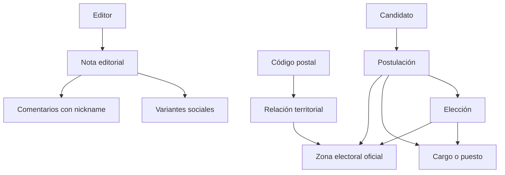

# Experiencia social editorial de MazaCrítica
_Sesión de brainstorming: 2026-10-14_

## Contexto

MazaCrítica será un medio editorial con una experiencia de frontend adaptada a patrones de Facebook, Instagram y TikTok. Las notas solo serán creadas y publicadas por editores de MazaCrítica. Las personas registradas podrán participar mediante comentarios usando un nickname, pero no crearán notas editoriales.

La portada debe permitir que una persona descubra una nota y entienda rápidamente su fuente, fecha y estado de la información. Las etiquetas sensibles deben usar lenguaje neutral y nunca presentar una sospecha como un hecho probado.

El producto también tendrá:

- Una sección específica para el Poder Judicial.
- Una base de datos de candidatos para elecciones presentes y futuras.
- Filtros electorales por código postal.
- Relaciones verificadas entre códigos postales y una o varias zonas electorales oficiales.

## Enfoques considerados

### Opción A: Feed primero el contexto

Cada nota muestra tipo, titular, resumen, fuente, fecha, estado de la información y etiquetas.

- Ventajas: comunica confianza rápidamente y evita que una sospecha parezca un hecho.
- Costos: requiere limitar los metadatos visibles para no saturar la tarjeta.

### Opción B: Feed primero los temas

Las etiquetas dominan la tarjeta y guían la exploración.

- Ventajas: favorece el descubrimiento temático.
- Costos: puede hacer que el contenido parezca una colección de temas antes que información documentada.

### Opción C: Tarjeta con panel de contexto

La tarjeta mantiene titular y resumen, mientras un panel lateral muestra fuentes, estados y relaciones.

- Ventajas: facilita una experiencia de investigación profunda.
- Costos: aumenta la complejidad y funciona peor en móvil.

## Enfoque elegido

Se eligió la **Opción A: Feed primero el contexto**. La nota editorial es la unidad principal y la comunidad conversa alrededor de ella.

## Diseño de la experiencia

### Portada editorial

La portada contiene:

1. Encabezado con marca, búsqueda y acciones de autenticación.
2. Introducción editorial.
3. Feed único de notas.
4. Pestañas de orden: Para ti, Más recientes y Más discutidas.
5. Filtros por etiquetas.
6. Rail de pulso, temas conversados y principios editoriales.

### Tarjeta de nota

Cada nota debe mostrar:

- Tipo de nota.
- Titular.
- Resumen.
- Fuente.
- Fecha de publicación.
- Estado de la información.
- Etiquetas.
- Identidad editorial de MazaCrítica.
- Acciones para guardar, compartir y comentar.

La tarjeta debe responder:

- ¿Qué ocurrió?
- ¿De dónde proviene la información?
- ¿Cuándo ocurrió o fue publicada?
- ¿Cuál es el estado de lo que se afirma?
- ¿Con qué otros contenidos se relaciona?

### Variantes sociales

La nota editorial será una fuente única con distintas presentaciones:

- **Facebook:** publicación con titular, resumen, fuente y conversación.
- **Instagram:** tarjeta visual o carrusel con frases clave, contexto y etiquetas.
- **TikTok:** guion vertical con gancho, resumen breve, contexto y referencia a la nota completa.

Las variantes no crean contenido independiente ni duplican la autoridad editorial.

### Comentarios

- Solo usuarios registrados pueden comentar.
- Los comentarios muestran nickname.
- Los visitantes pueden leer comentarios, pero deben registrarse para participar.
- Se contempla responder, reportar y moderar.
- Los comentarios no se mezclan visualmente con las notas editoriales.
- Los comentarios pendientes o moderados deben tener un estado visible.

### Permisos

| Acción | Visitante | Usuario registrado | Editor |
|---|---:|---:|---:|
| Leer notas | Sí | Sí | Sí |
| Leer comentarios | Sí | Sí | Sí |
| Crear nota | No | No | Sí |
| Comentar | No | Sí | Sí |
| Responder | No | Sí | Sí |
| Reportar comentario | No | Sí | Sí |
| Moderar comentario | No | No | Sí |
| Generar variante social | No | No | Sí |

## Sección del Poder Judicial

La sección del Poder Judicial permitirá consultar:

- Noticias y notas editoriales relacionadas.
- Resoluciones y procesos.
- Personas representantes del sistema judicial.
- Elecciones judiciales cuando correspondan.
- Estados neutrales como investigación en curso, resolución pendiente y resolución firme.

## Base de datos electoral

La estructura conceptual será:

### Entidades principales

#### Elección

- Nombre.
- Fecha.
- Estado: próxima, en curso, concluida o cancelada.
- Tipo: ordinaria, extraordinaria, judicial u otra modalidad.
- Fuente oficial.

#### Cargo

- Nombre del cargo.
- Poder: Ejecutivo, Legislativo o Judicial.
- Nivel de gobierno.
- Descripción.

#### Candidato

- Nombre público.
- Nombre completo.
- Fotografía, si existe.
- Biografía editorial.
- Fuentes.
- Estado de verificación.

#### Postulación

Relaciona candidato, elección, cargo y zona. También conserva partido, coalición o candidatura independiente, junto con el estado de la postulación: registrada, en revisión, aprobada, retirada o no confirmada.

#### Código postal

Conserva código postal, país, estado o provincia, municipio o alcaldía, localidad y su relación con una o varias zonas electorales oficiales. La relación debe incluir fuente y vigencia.

### Flujo electoral

1. La persona elige una elección presente o futura.
2. Introduce su código postal.
3. El sistema consulta las zonas electorales relacionadas.
4. Si hay más de una zona, la persona selecciona la correcta.
5. Se muestran los cargos y candidaturas aplicables.
6. Se puede abrir el perfil de cada candidato y consultar notas relacionadas.

El código postal es el punto de entrada para la persona usuaria, pero no reemplaza la zona electoral oficial. La asignación debe ser verificable y fechada.

## Arquitectura de componentes

- `EditorialShell`: composición responsive y landmarks.
- `Navigation`: navegación principal y estados activos.
- `EditorialFeed`: orden, filtrado y estado vacío.
- `EditorialNoteCard`: presentación editorial, fuente, estado y etiquetas.
- `SocialVariantPreview`: vistas para Facebook, Instagram y TikTok.
- `CommentSection`: lectura, composición y moderación futura.
- `EditorIdentity`: autoría y trazabilidad editorial.
- `ElectionExplorer`: elección, código postal y selección de zona.
- `CandidateCard`: candidatura, cargo, zona y fuentes.
- `ContextRail`: pulso, conversación y principios editoriales.

## Estados y errores

- Feed cargando.
- Feed vacío.
- Búsqueda sin resultados.
- Nota sin comentarios.
- Visitante intentando comentar.
- Comentario enviado.
- Comentario pendiente de moderación.
- Nota con investigación en curso.
- Nota con resolución firme.
- Código postal no encontrado.
- Código postal relacionado con múltiples zonas.
- Elección sin candidaturas confirmadas.
- Error de carga o conexión.

## Principios de producto

1. MazaCrítica produce y publica las notas.
2. Las fuentes respaldan la información.
3. Las etiquetas explican tema y estado sin dictar culpabilidad.
4. La comunidad conversa alrededor de una nota editorial.
5. Facebook, Instagram y TikTok son canales de presentación y distribución.
6. El código postal facilita la búsqueda, pero la zona oficial determina la elegibilidad electoral.

## Preguntas abiertas

- ¿Qué autoridad o fuente oficial validará la relación entre código postal y zona electoral?
- ¿Cómo se resolverán cambios de límites electorales a lo largo del tiempo?
- ¿Qué políticas de moderación y apelación tendrán los comentarios?
- ¿Qué nickname se permite y cómo se evita la suplantación?
- ¿Qué formatos concretos exportará el editor para Instagram y TikTok?
